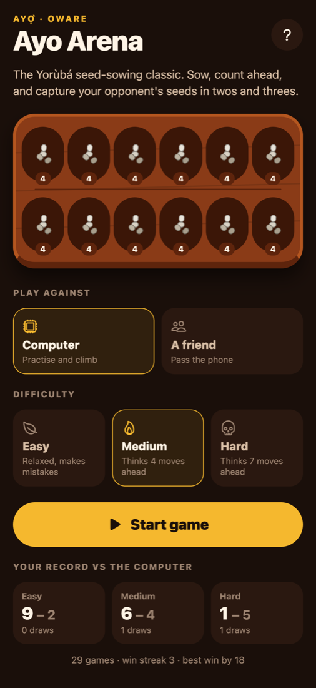
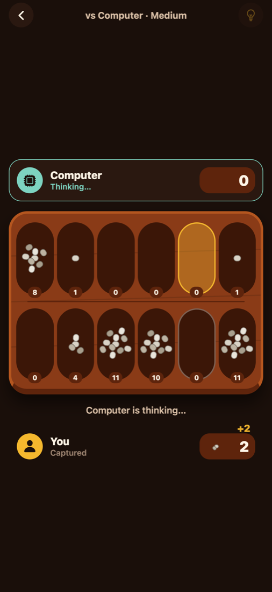
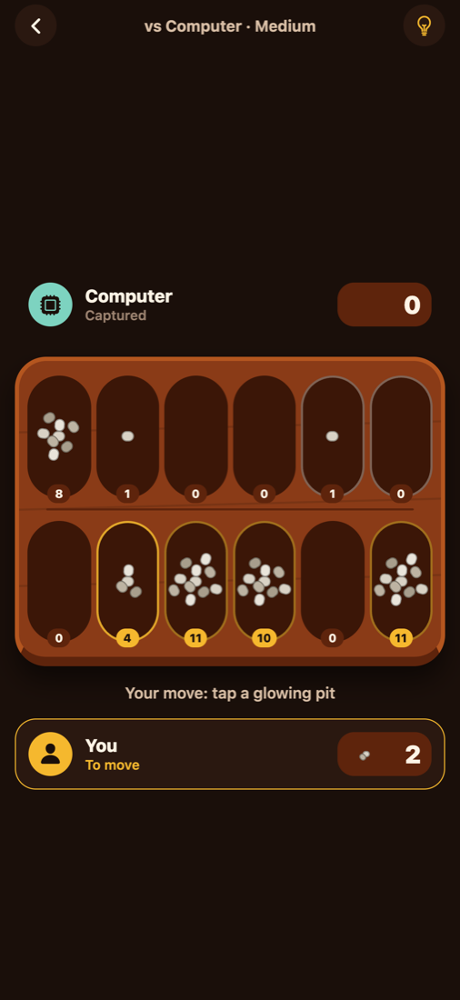
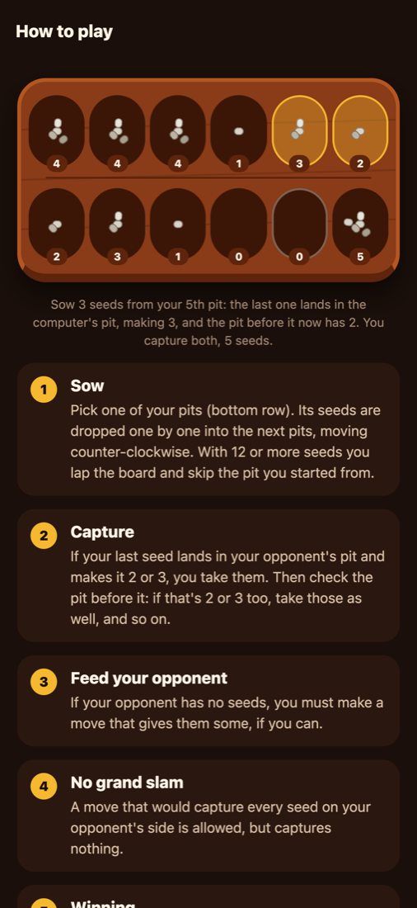

<p align="center">
  
</p>

<h1 align="center">Ayo Arena</h1>

<p align="center">
  <strong>The Yorùbá seed-sowing classic, in your pocket.</strong><br />
  Play Ayọ̀ (Oware) against a computer that thinks up to seven moves ahead, or pass the phone to a friend.
</p>

<p align="center">
  
  
  
  
  
</p>

<p align="center">
  
  
  
  
</p>

---

## Why Ayo Arena

Ayọ̀ is played on carved wooden boards across Yorùbá land and, as Oware and Awalé, all over West Africa. It's a game of counting ahead: every move changes six pits at once. Ayo Arena keeps the real rules and the feel of a wooden board, and gives you an opponent that's ready whenever you are.

## Features

| | |
|---|---|
| **The real rules** | Counter-clockwise sowing that skips the origin pit, chain captures of 2s and 3s, the must-feed rule, no grand slam, first past 24 wins, and a cycle limit so games always end. |
| **Computer opponent** | Alpha-beta minimax at three levels: *Easy* (one move ahead, sometimes careless), *Medium* (four ahead), *Hard* (seven ahead). |
| **Pass and play** | Two players on one phone. |
| **Feels like a board** | Carved wooden board, seed piles that look like real ayo seeds, seed-by-seed sowing animation, captured pits flash gold with a "+N" on your score, haptics on every move and capture. |
| **Hints** | Stuck? The bulb suggests a move and the pit pulses. |
| **Your record** | Wins, losses and draws per difficulty, your win streak and your biggest win, saved on the phone. |
| **How to play** | Five short rules with an illustrated capture. |
| **Accessible** | Every pit is announced with its owner, seed count and whether you can play it; turn changes are announced. |

## How the computer plays

The engine in [`src/game/ayo.ts`](src/game/ayo.ts) is pure TypeScript with no React, so it's fast to test and easy to reuse. `bestMove` searches the game tree with alpha-beta pruning; positions are scored by the seed difference in the stores plus a small bonus for seeds on your own side, and finished games are scored decisively. On *Easy*, 40% of moves are random, so beginners can win.

## Tech

- **Expo SDK 58** (React Native 0.88, React 19.3), Expo Router, TypeScript (strict), React Compiler
- `expo-haptics`, AsyncStorage for the record
- **Jest** + React Native Testing Library

```
src/
  app/          index (menu), game, how-to-play
  game/         ayo.ts (rules + AI), board.tsx, seeds.tsx, look.ts
  data/         record.ts (wins, streaks, best margin)
__tests__/      rules, AI and real screen flows
```

## Getting started

```bash
npm install
npx expo start          # press i for iOS, a for Android, w for web
```

### Tests

```bash
npm test                # 20 tests
npx tsc --noEmit
npx expo lint
```

The tests check every rule (sowing and lapping, chain captures, no captures on your own side, grand slam, must-feed, all three endings), play 300 random games to make sure all 48 seeds are always accounted for and every game ends, confirm the computer finds a winning capture and that *Medium* beats random play 20 out of 20, and drive the real screens: the menu, a pass-and-play move, the computer replying, and the hint.

## Roadmap

- [ ] Sound of seeds dropping
- [ ] Online play with friends
- [ ] Yorùbá-language UI
- [ ] Regional rule variants as options

## Author

Built by **Olateju Olamide Emmanuel**, mobile developer & ML engineer.
[Portfolio](https://tejusportfolio.vercel.app) · [GitHub](https://github.com/tejHacks) · [LinkedIn](https://www.linkedin.com/in/olateju-olamide-22314a292/)

## License

MIT, see [LICENSE](LICENSE).
